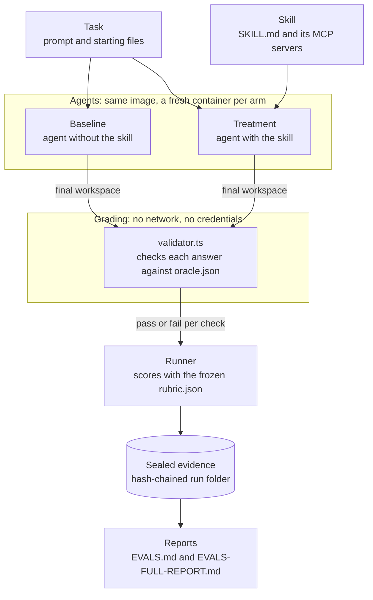

# How it works

Arb Evals Guidelines answers one question: **does this skill make the agent better at this task?** To find out, we run the same task twice (once without the skill, once with it), grade both answers with the same deterministic code and keep the evidence so anyone can check the result.

It measures one skill on one task. It's not a benchmark, a statistical test or an LLM judge.

## Architecture

1. **Freeze.** The runner copies and hashes the case (prompt, files, rubric, validator and oracle) and the skill before anything runs.
2. **Run.** Both arms get the same prompt and files, each in its own fresh container from the same image. Only the treatment has the skill.
3. **Grade.** The validator checks each final workspace against the oracle, offline and without a model.
4. **Score.** The runner turns the check results into a score with the frozen rubric.
5. **Seal.** Everything is hashed into the run folder and the reports are generated from it, so anyone can verify the result.

## Scoring rubric

Arb Evals Guidelines standardizes **how** we score; each case defines **what** a correct answer is.

| Pillar | What we measure |
|---|---|
| **Accuracy** | Shown as **Score**: points out of 100 from the case's checks. |
| **Cost** | Recorded tokens, including cached input. |
| **Latency** | Milliseconds from the arm's prompt until it finishes or is stopped. |

Each pillar is reported as **Baseline → Treatment** with the change. With several pairs, it's the mean over the pairs graded in both arms.

### Accuracy: outcome and constraints

Accuracy has two fixed groups. The weights belong to the framework, not to the case, so a score means the same thing in every case:

- **Outcome (80 points):** did the agent deliver what was asked, correctly and completely? That includes handling any predefined failure or invalid input the way the case expects.
- **Constraints (20 points):** did it stay inside the task boundaries and leave alone what it shouldn't touch?

### Rubric, validator and oracle

Each case grades with three files. The agent never sees any of them.

| File | What it does |
|---|---|
| `rubric.json` | Declares every check: `id`, `group` (`outcome` or `constraints`), display `topic` and `points`. Checks that share a topic are shown together in the reports. Outcome checks must add up to 80 and constraints to 20, or the rubric is rejected. |
| `validator.ts` | One deterministic pass/fail predicate per check. It runs in the grading container and never calls a model. |
| `oracle.json` | The expected answers and their sources. |

For example, [`network-config-01`](../eval-cases/network-config-01/rubric.json) has 16 outcome checks worth 5 points each, grouped into 8 topics, plus two constraint checks (`json-shape` and `preservation`) worth 10 points each.

### Grading rules

- **Deterministic.** The same answer and the same oracle always give the same result.
- **All or nothing.** A check earns its full points or 0, and a full pass needs every check.
- **The runner has the final say.** The validator reports pass or fail per check, and the runner computes the score from the frozen rubric (any score the validator returns is advisory). If the validator's checks don't match the rubric one to one, the arm gets no score instead of a wrong one.
- **Task failures and infrastructure failures stay apart.** If the agent gets it wrong or leaves no answer, the arm is still graded and can score 0. If something breaks on our side, the arm has no score and that pair reports no change.
- **Validators are tested.** `validator.test.ts` must show that wrong answers fail and accepted variants pass.

## Sandboxed environment

Each arm runs in its own fresh Apple Container, built from the same pinned image. Inside, the agent works as a non-root user on a read-only root filesystem and only gets API keys in memory, never in files or arguments. It can reach public internet addresses, but private and local network ranges are blocked (details in [`container/configure-egress.sh`](../container/configure-egress.sh)).

## Evidence and cleanup

Every run is sealed in `eval-cases/<case-id>/runs/<run-id>/` and committed. A receipt and a manifest hash every file, and `eval:report` and `eval:inspect` verify that chain before showing anything, so editing a sealed file breaks verification. `views/` and the two reports sit outside the chain because they're always regenerated from the sealed files.

Each arm's containers and networks are destroyed afterwards, and that cleanup is verified before the next pair starts. If an interrupted run leaves anything behind, run `pnpm eval:recover -- --run <run-id>`.

With several `--model` values, each model gets its own sealed run, and the combined `EVALS.md` built from them is generated, not sealed (see [Combine existing runs](running-evals.md#combine-existing-runs)).
