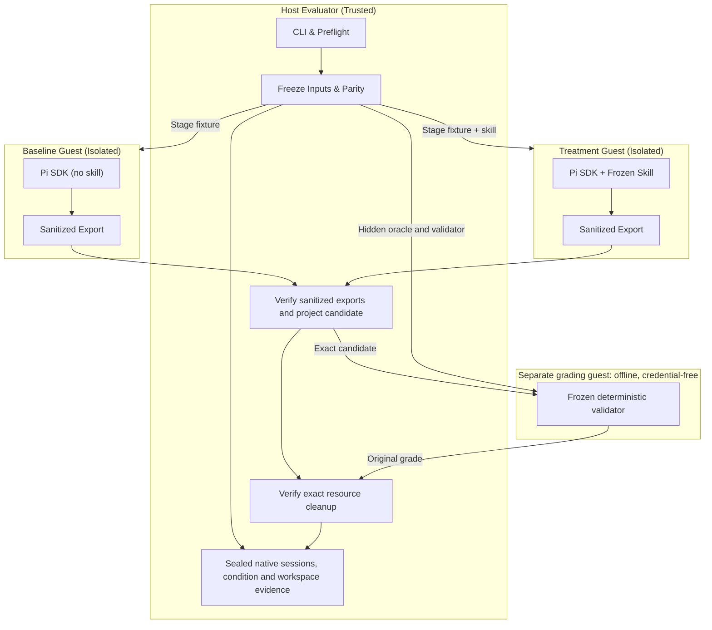

# Skill Evaluation Architecture — V1 Contract

> **OWNER-CONTROLLED CONTRACT.** Implementation agents MUST read this file. Only an
> expressly owner-authorized reconciliation may edit it. Repair implementation defects
> without weakening guarantees. If a guarantee cannot be met, pause dependent work and
> continue independent authorized work; changing the guarantee requires an explicit
> owner decision.

This contract defines stable guarantees of the developer-only `evals/` subsystem,
not claims that every implementation gate has passed. Exact versions,
fixture facts, protocol schemas and shell mechanics belong in locks, case data and code.
Measured results and their limitations belong in the evidence a run seals and in
[README.md](README.md).

## 1. Scope, non-goals, and layout

### Purpose

Measure the effect of exactly one agent skill on one task by comparing two arms:

- **baseline** — a fresh guest containing the harness runtime and **no** evaluated skill;
- **treatment** — a different fresh guest from the **same image digest**, containing the
  harness runtime and **exactly one** frozen copy of the evaluated skill.

The skill is the only intended difference between the arms. Everything the subsystem
produces exists to make that claim inspectable and falsifiable.

### Non-goals

- Not a feature of the published CLI, MCP server, or package surface. No published entry
  point, command, export, or dependency may change to serve this subsystem.
- Not a benchmark suite, leaderboard, or statistical authority. A single pair is a smoke
  test.
- Not an offline task sandbox. Guests isolate the host; both arms receive the same
  bounded public internet.
- Not a plugin framework. Interfaces exist for testability and one V1 implementation each.
- Not an LLM-judge system. V1 grading is deterministic code.

### Approved tree

```text
evals/
├── ARCHITECTURE.md          # This contract
├── README.md                # One-page quick reference: running, table, and evidence inspection
├── .env.example             # Empty direct-provider credential variables
├── tsconfig.json            # Eval-only typecheck
├── src/
│   ├── core/                # Pure contracts, parity, limits, schedule, paths, hashes
│   ├── runner/              # Preflight, case loading, snapshot, validation, orchestration
│   ├── harnesses/           # Narrow harness contract + implementations
│   ├── sandboxes/           # Narrow guest/image/network contract + implementations
│   └── artifacts/           # Journals, immutable seals, verified read models
├── scripts/                 # Thin argument/composition entrypoints only
├── container/               # Build context, image locks, guest-side policy and supervisor
├── .state/                  # Generated, ignored, exact-ID journals
├── cases/                   # Canonical cases, independent of selected --skill
│   └── <case-id>/
│       ├── {case.json,fixture/,oracle.json,validator.ts,validator.test.ts}
│       └── runs/            # Generated, ignored evidence
└── <suite>/                 # Legacy suite compatibility
    ├── eval.json
    ├── cases/<group>/<case>/{case.json,fixture/,oracle.json,validator.ts,validator.test.ts}
    └── runs/                # Generated, ignored evidence
```

Folder responsibilities are exclusive:

- `core/` owns meaning: identifiers, schemas, limits, parity, scheduling, path safety,
  canonical serialization, and hashing.
- `runner/` owns orchestration: preflight, freezing inputs, arm sequencing, validation
  dispatch, cleanup, and sealing.
- `harnesses/` owns "how a prompt is executed by an agent runtime".
- `sandboxes/` owns "how an isolated guest, image, and network exist and stop existing".
- `artifacts/` owns "what is written, what is immutable, and how it is read back".
- `scripts/` owns argument parsing and composition, and contains no policy or algorithm.
- `container/` owns the guest-side build context, locked identities, guest policy, and
  the bounded guest supervisor.
- Canonical case directories and legacy `<suite>/` directories own data: prompt,
  fixture, oracle, validator, and case metadata. CLI selection reuses these existing formats.

Colocate `*.test.ts` with the code under test and run it in the repository's existing
test runner. Owner-authored case validator tests may use their own runner; wiring them in
must not modify owner-authored case files.

### Document roles

| Document | Authority and scope |
| --- | --- |
| `evals/README.md` | Consolidated operator guide: quick start, methodology, prerequisites, grading, metrics, inspection, reproduction, and limitations |
| `evals/ARCHITECTURE.md` | Frozen contract: stable guarantees, lifecycle partial order, isolation, and evidence contracts |
| `skills/<skill>/EVALS.md` | Per-skill measured results for that skill, excluded from agent-visible skill snapshots |

## 2. Dependency direction and core purity

```text
scripts → runner → core (pure)
              ├── harness implementation
              ├── sandbox implementation
              └── artifact store / read models
suite + case data ─────────↑
```

### Stable boundary diagram



- `core/` MUST NOT import filesystem, process, child-process, network, container,
  provider, harness, or suite-specific modules, and MUST NOT branch on a specific case,
  skill, provider, or image. Deterministic hashing and encoding are permitted.
- Concrete modules depend inward on `core/` contracts. `core/` depends on nothing local.
- Interfaces live beside their sole V1 implementation. No `application/ports/adapters`
  layering, and no registry indirection where a direct import suffices.
- Environment and CLI input are parsed exactly once, at the process boundary. Deep
  modules receive resolved values; they MUST NOT read ambient environment or argv.
- Every limit resolves in the order CLI > case > suite > profile > safe default, and is
  frozen before dispatch. Unresolved or invalid limits are a preflight failure.
- Credential access follows an explicit flow: the boundary parser loads only the selected
  provider credential; the in-memory transport delivers it after attestation; the guest
  runtime consumes it for native completion; guest/host sanitizers use explicitly supplied
  secret material to redact and verify exports. No other host module discovers or loads
  credentials. Explicit delivery within the guest credential boundary is not ambient
  credential discovery; neither values nor scanned encodings may enter durable evidence.

## 3. Fixed paired conditions and the parity rule

- The public condition vocabulary is exactly `baseline` and `treatment`. The internal
  representation is a fixed two-item tuple in that order. Arbitrary N-way variants,
  ad-hoc arm names, and single-arm runs are out of contract.
- A **pair** is one repetition of both conditions for one case.
- All of the following are resolved once per run, frozen, and bound identically to both
  conditions of a pair: prompt text; fixture content; requested output path; oracle;
  validator identity; allowed tools; harness identity and configuration; sandbox
  identity; runtime profile and final image digest; provider, exact model, and thinking
  level; every limit; network policy; guest policy; validation procedure; and execution
  policy.
- The **only** permitted difference is skill presence, and a skill is a **bundle**: its
  prose plus the tool dependencies it declares in its own manifest. Baseline receives zero
  skill paths and no skill-declared tools; treatment receives exactly one frozen
  evaluated-skill path and, when that bundle declares them, its declared tools
  (Amendment 9). Evaluator-provided ambient tools are not skill presence: they are
  registered identically in both arms and hashed into the execution policy.
- Parity is enforced by comparing the two frozen condition plans field by field before
  the first guest is created. A mismatch outside skill presence aborts the run before any
  paid request. The frozen declaration itself is hashed and bound to **both** arms, so the
  pair provably planned against one declared tool bundle even though only treatment
  provisions it.
- Ambient skill, context, plugin, and configuration discovery is disabled in both arms.
  Skill presence is explicit or absent, never inherited.

## 4. Runtime profiles and same-digest pairs

- A case or suite selects one allowlisted runtime profile identifier. Unknown identifiers are a
  preflight failure. Profile selection resolves from an allowlisted catalog without domain-specific
  branches in core.
- A profile identifier maps through a lock file to a pinned base identity and recipe. The
  build adds locked runtime and harness identities and yields a content-addressed image.
- Verified immutable cached images are treated as shared build assets across runs, not
  per-run resources that must be destroyed after every run.
- The build context contains only allowlisted `container/` content. The repository root,
  the evaluated skill, the fixture, the oracle, the validator, tests, credential files,
  and any answer MUST NOT be reachable from the build context.
- Both conditions of a pair MUST run from one inspected final image digest, recorded in
  evidence. Different cases may resolve different profiles and digests.
- Adding a profile MUST NOT change pair orchestration, parity enforcement, validation, or
  evidence structure.

## 5. Harness, sandbox, and provider boundaries

- `Harness` is the only interface through which a prompt is executed. It accepts a frozen
  request (prompt, workspace, skill paths, allowed tools, limits, provider, model,
  thinking) and returns normalized, bounded evidence plus an outcome classification. It
  MUST NOT decide parity, scoring, cleanup, or evidence layout.
- The agent harness executes using the Pi SDK directly inside each guest boundary,
  replacing external CLI/RPC integration.
- `Sandbox` is the only interface through which images, networks, guests, staging,
  bounded export, and destruction happen. It MUST NOT interpret prompts, scores, or
  provider semantics.
- The harness runtime owns completion transport. The evaluator MUST NOT implement or
  proxy provider HTTP, retries, streaming, or model routing.
- Supported providers are exactly the harness-native direct Google and Anthropic providers,
  each with one declared credential variable. The exact model is an explicit CLI input;
  provider resolves only from a unique exact match in the existing admitted catalog.
  Optional `--provider` checks or disambiguates that match. Both resolved values are frozen
  explicitly in the target before credentials are loaded.
  Credential presence MUST NOT select a provider or model, and there is no fallback,
  substitution, or silent retry across providers or models.
- The evaluator adds no MCP server or proxy. Both arms receive the same generic MCP
  client extension and tool interface, alongside identical ambient tools. Baseline starts
  with no configured MCP servers; only treatment receives server configurations from the
  selected skill's frozen manifest. Either agent may discover and connect to public MCP
  endpoints through the shared client. With no declared servers, the client is available
  but makes no connections during setup. Connections and tool calls remain local to each
  arm and are recorded in its session. A live external MCP is a live-web dependency with
  the same non-determinism caveat as any other public network access.
- Every implementation of these interfaces MUST satisfy the same conformance tests
  without changing experiment semantics.

## 6. Lifecycle

These are lifecycle responsibilities, constrained by the partial order below, not an
unskippable total order of implementation calls. Failed/not-started arms may omit execution
or grading, but never required cleanup or explicit partial evidence.

1. **Preflight** — strictly decode CLI, suite, case, oracle, validator identity, provider,
   model, profile, and limits. Reject unknown fields, duplicate identifiers, ambiguous
   selectors, unsafe paths, symlinked inputs, and invalid limits. No paid request may
   occur before preflight passes.
2. **Freeze** — snapshot and hash prompt, fixture, evaluated skill, case metadata, oracle,
   validator, target (provider/model/thinking), limits, policies, image identity, source
   revision and dirty state, evaluator build identity, and arm order. Versioned complete
   input snapshots are written before dispatch and never rewritten. Bounded trusted
   preparation once before freezing is permitted where configured, sharing frozen bytes
   across both arms and all repetitions.
3. **Execute** — run conditions with fresh isolated state per arm. BOTH arms must reach
   the shared readiness barrier before either is prompted, including under serial execution.
   Conditions of one pair may overlap; an explicit serial prompting option is retained.
   At most one pair runs in flight (two active agents maximum). Before another pair begins,
   verified cleanup of all guest and network resources for the previous pair MUST be confirmed.
   Each condition and repetition receives a new guest, network, workspace, home, harness state,
   and temporary state.
4. **Capture and validate** — verify stopped execution before bounded output capture;
   sanitize and verify exports, then project a candidate (bounded workspace collection for
   every fresh run; the recorded mode for retained inputs, Amendment 11) and grade
   it with the same validator for both arms, isolated from model guests, with
   no network and no credential, over a read-only candidate, and with no host execution of
   guest-authored code.
5. **Clean up** — destroy every journaled exact identity on success, error, signal, or
   timeout. Verified immutable cached images are shared build assets, not per-run resources
   to destroy. Cleanup targets journaled identities only; broad name or label scans are
   forbidden. If cancellation settlement cannot be confirmed in the bounded cleanup
   window, the run is recorded partial with `cleanup-failed` and `verified: false`; paid
   execution stops and recovery later reconciles the exact identities.
6. **Seal** — write immutable condition, pair, manifest, and receipt records only after
   cleanup outcomes are known. Incremental sanitized evidence may be retained before sealing.

**Separate operations**, not mandatory stages of each run:

- **Report and inspect** — read-only views recomputed from verified sealed evidence.
- **Recover** — exact-run-identifier cleanup that verifies and destroys leftovers and
  appends a recovery record and receipt. Recovery MUST NOT edit or delete prior evidence,
  and MUST NOT re-run a task.

Required partial order: preflight and any bounded trusted preparation precede freezing;
freeze and parity precede dispatch; guest attestation precedes credential delivery;
both arms ready precedes either prompt, even serially; verified stopped execution precedes
output capture; known cleanup outcomes precede sealing, and verified pair cleanup precedes
the next pair. Failure cannot turn an unverified stop into a gradeable task outcome.
The 300,000 ms default and 600,000 ms maximum are per-arm limits. The overall invocation
watchdog is separate and reserves startup, cleanup, and sealing infrastructure time.

Rules that bind the lifecycle:

- Every external effect is journaled with its exact intended identity, name, label, and
  nonce **before** invocation; observed identities are appended after.
- After a cleanup failure or a secret-quarantine event, no further paid call may be made
  in that run.
- A run MUST NOT automatically re-execute a task to obtain a better task result.
- Arm order may be varied only if the order is recorded in evidence and parity is
  preserved.

## 7. Host, privilege, network, credential, and trace boundaries

- Never bind-mount or otherwise expose the host repository, home directory, caches,
  credential stores, or sockets into a guest. Only the frozen fixture and, for treatment,
  the frozen evaluated skill are staged.
- Guests run with a read-only root plus explicitly bounded writable paths, and with
  identical CPU, memory, process, disk, time, token, tool-step, request, and network
  limits across the pair.
- No writable state is shared between conditions, repetitions, or runs.
- A privileged guest entrypoint may perform only credential-free ownership and egress
  setup. It MUST clear supplementary groups and capabilities, set no-new-privileges,
  switch to a fixed non-root user, and exec the supervisor. This must be attested before
  any credential is delivered. If it cannot be attested, the run is blocked.
- Egress policy allows locked public name resolution and public web transport only. Host,
  gateway, loopback, private, link-local, metadata, and sibling ranges are denied for
  both IP families. A host or private resolver MUST NOT be inherited. Policy drift is
  probed before staging, during execution, and after quiescence.
- A credential is delivered only after attestation, in memory, over the established
  control channel, and only as an allowlisted environment entry inside the guest. A
  credential value MUST NOT appear in a build, image, argument vector, guest run
  specification, file, log, trace, hash, view, or artifact.
- All streams, protocol records, exported files, tool steps, provider requests, and wall
  time are bounded. An unknown harness event, type, or field fails closed.
- Exported output is stripped of private reasoning and signatures in the guest, scanned
  for secret echoes in the guest, and validated and scanned again on the host before
  promotion. Scanning covers raw and common encoded forms.
- On contamination, every occurrence MUST be redacted before export and before sealing.
  No secret byte, in any scanned encoding, may reach an exported file, a transcript, a
  log, a hash, a view, or any sealed artifact. This is absolute and is not relaxed by the
  paragraph below.
- A credential echo produced by the evaluated agent is **agent behaviour, not an
  infrastructure fault**. Once redaction is applied and verified, the condition remains
  gradeable and the pair remains valid. The redaction MUST be recorded in evidence,
  including how many occurrences were removed and where, so the echo is auditable.
  (Owner-approved amendment, 2026-09-05: this replaces an earlier rule that discarded the
  output and invalidated the pair. Rationale: agents are given real shell access, so an
  agent reading its own environment is expected and must not destroy the experiment.)
- If redaction cannot be verified — that is, if a secret survives the host re-scan — then
  the original rule applies unchanged: staged output is discarded, only a redacted failure
  is retained, paid work stops, cleanup runs, and the credential is treated as
  compromised.
- Raw harness sessions, on-disk agent state, and private reasoning MUST NOT be exported
  or retained. Canonical sanitized native-compatible sessions are integrity-bound artifacts
  within sealed evidence. Derived inspection/HTML views live outside the hash chain, not
  the canonical sessions they read. Raw sessions, private reasoning traces, signatures and
  credentials remain strictly prohibited from durable evidence.
- The harness and its guest tools share the guest credential boundary. This subsystem
  therefore claims host isolation, not protection from a malicious skill, and requires a
  dedicated low-limit revocable evaluation credential.

## 8. Validation, evidence, and reproducibility

- The oracle and validator MUST NOT exist inside a model guest, image, or workspace.
- The bounded exported workspace and the projected candidate that the validator actually
  scored remain separately identifiable and independently verifiable. Here, "raw workspace"
  means sanitized, secret-scanned pre-projection bytes, NEVER unsanitized secret-bearing
  output. Candidate projections may reference those retained bytes without collapsing the
  workspace and candidate distinction.
- Generic case contracts are permitted: empty starting fixtures, initially absent outputs
  (new-file creation), bounded trusted preparation once before freezing, and data-selected
  locked profiles. Candidate projection is not case-authored: every fresh run resolves to
  bounded `workspace` collection before freezing, policy hashing, and dispatch, and a fresh
  case requesting `file` is rejected at preflight (Amendment 11). Retained inputs keep their
  recorded projection mode, frozen validator, and policy hashes, so historical `file`-mode
  evidence reproduces unchanged. Existing case and rubric bytes are strictly preserved
  outside explicitly versioned case changes.
- The validator receives only the projected candidate, the frozen fixture, the requested
  output path, and the oracle. It MUST be a deterministic pure function of those inputs
  and MUST be identical for both arms of a pair.
- Evidence uses schema-versioned canonical serialization, versioned input/evidence snapshots,
  and content hashes over a sorted file tree. The immutable chain is
  receipt → manifest → pair → condition → artifacts.
- Sealed evidence is write-once, including canonical sanitized native sessions. Reports,
  queries and inspection verify the chain and MUST NOT mutate evidence. Derived views,
  including HTML, are regenerable, live outside the hash chain and are not authoritative.
- No mutable `latest` pointer, alias, or symlink into a run may be created.
- Each arm's inspection exposes condition details, messages, tool steps and workspace
  output together with its native Pi session header, entries and honest incomplete tail.
  Messages and tool views derive from canonical native entries; condition and workspace
  artifacts remain integrity-bound alongside them, not invented native conversation turns.
- Retained evidence includes canonical sanitized native sessions (from which normalized
  messages and tool views are derived), bounded workspace, candidate records, checks,
  errors, timing, usage, cleanup outcomes, and resolved runtime identity — never secrets
  or private reasoning.
- Evidence MUST record the resolved harness and sandbox identity, including whether an
  implementation is a deterministic test double. Evidence produced with a test double
  MUST be self-labeled as such and MUST NOT be presented as a measured result.

## 9. Failure semantics

- **Task outcome** — gradeable. A wrong, missing, malformed, or unusable answer, and a
  task-level limit stop, are graded, and may score zero.
- **Infrastructure outcome** — not gradeable, `score: null`. Provider failure, human or
  tooling intervention, image, guest, network, protocol, evidence, validator
  infrastructure, interruption, cleanup, and secret-quarantine failures are
  infrastructure outcomes.
- An infrastructure outcome MUST NOT be recorded as a task failure, and a task failure
  MUST NOT be relabeled as infrastructure.
- A delta MUST NOT be computed, reported, or aggregated unless both conditions of the
  pair are gradeable.
- A condition that never started after an early stop is sealed as an explicit
  not-started record, together with the known cleanup outcome.
- Partial evidence is sealed and inspectable; it is never silently discarded or completed
  with inferred values.

## 10. Extension recipes

- **New case or suite** — add a canonical case under `evals/cases/<case-id>/`, or add a
  legacy suite under `<suite>/`. No change to `core/`, harness, sandbox, or provider code.
- **New dependency set** — register a runtime profile and its lock entry. One digest per
  pair is preserved. A compiled-language profile may add a workspace or compiler
  validator without touching pair orchestration.
- **New direct provider** — requires separate owner-approved scope beyond Google/Anthropic;
  then add the allowlist entry, credential template line and boundary tests. No
  evaluator-owned completion transport.
- **New harness, sandbox, or validator** — satisfy the existing interface and the existing
  conformance tests without changing experiment semantics.
- **Skill-declared MCP server configuration** — approved by Amendment 9 for the treatment arm only; the client extension is shared by both arms,
  read from the skill's own frozen manifest.
- **Evaluator-authored MCP tooling not declared by a skill, host-routed local models,
  N-way variants, remote sandboxes, or LLM judges** — separate owner-approved
  architecture work.

## Rules agents must not break

- [ ] Never break pair parity: the only difference is skill presence, including the tools
      the skill's own frozen manifest declares. Ambient evaluator tools go to both arms.
- [ ] Never rely on ambient state, ambient credentials, or ambient skill discovery.
- [ ] Never place a skill, fixture, oracle, validator, test, or answer in an image or
      build context.
- [ ] Never share writable state between conditions, repetitions, or runs.
- [ ] Never execute untrusted guest-authored code on the host.
- [ ] Never export raw harness sessions or private reasoning.
- [ ] Never score an infrastructure failure as a task failure.
- [ ] Never compute or report a delta for an invalid pair.
- [ ] Never mutate a built image identity or sealed evidence.
- [ ] Never write a final receipt before every cleanup outcome is known.
- [ ] Never present test-double evidence as a measured result.

## 11. Approved contract amendments

The owner-approved decisions below are already incorporated into the contract above; the
per-amendment notes are consolidated into this summary:

- Pi SDK runs inside each isolated guest. Both arms have the same MCP client extension and ambient tools such as `glob`; only treatment adds the selected skill and its declared MCP server configuration. Baseline starts with no skill or seeded servers but can use the shared client to connect to endpoints it discovers.
- New runs default to measured Pi + Apple Container + isolated grading, validating case, skill, exact model/provider/thinking and effective limits before any credential or resource access; explicit fake mode makes no paid calls and Pi test compositions stay guarded and scripted.
- Each child's prompt budget defaults to 300000 ms (max 600000 ms), identical per arm and timed from its own prompt so preparation and serial waiting never consume it, with layered runner/CLI/guest watchdogs guarding every stage and rejecting timer overflow.
- Every fresh run collects the bounded final workspace as the candidate — cases author no candidate mode and `outputPath` no longer filters collection — a fresh `file` request is refused at preflight, and case-owned trusted preparation may run once before freezing.
- Retained/`--from` evidence keeps its recorded mode and frozen validator/config/policy hashes; immutable cached images are shared build assets with exact per-pair digest parity, and sanitized native sessions and versioned snapshots stay write-once, hash-chained, and read-only.
